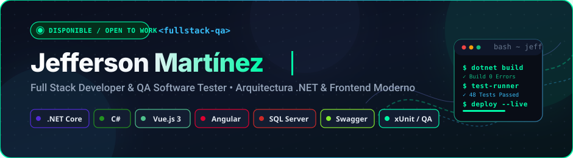

  

&nbsp;

&nbsp;

---

## 📡 01 — API RESTful .NET Core + Swagger + JWT

> **Arquitectura robusta, documentación interactiva y pruebas de integración automatizadas**

  
  
  
  

### 🎯 Descripción General
Servicio backend de nivel profesional estructurado bajo principios de Clean Architecture y Repository Pattern. Ofrece endpoints protegidos y documentados en tiempo real mediante Swagger UI, facilitando el consumo seguro y eficiente por parte de clientes web y móviles.

### ✨ Aspectos Clave
- **Documentación Interactiva:** Especificaciones OpenAPI 3.0 mediante Swagger con soporte para envío directo de tokens Bearer.
- **Seguridad Robusta:** Autenticación y control de acceso basado en roles (RBAC) con JSON Web Tokens (JWT).
- **Acceso a Datos Eficiente:** Consultas optimizadas con Entity Framework Core, migraciones automáticas y transacciones.
- **Manejo Centralizado de Excepciones:** Middleware personalizado para capturar errores y retornar respuestas estandarizadas JSON (`ProblemDetails`).
- **Pruebas Automatizadas:** Suite de tests unitarios con xUnit asegurando cobertura en controladores y servicios de dominio.

| Capa / Módulo | Tecnología Implementada |
| :--- | :--- |
| **Framework** | .NET Core 7 / C# |
| **Especificación API** | OpenAPI 3.0 / Swagger UI |
| **Seguridad** | ASP.NET Identity + JWT Bearer Tokens |
| **Persistencia** | Entity Framework Core (Code-First) |
| **Testing** | xUnit + FluentAssertions + Moq |

[📂 Explorar Repositorio en GitHub](https://github.com/jeffersonm-dev/api-dotnet-swagger)

---

## 🖥️ 02 — Aplicación Full Stack Vue.js 3 + SQL Server

> **Single Page Application reactiva conectada a backend .NET Core y base de datos relacional**

  
  
  
  

### 🎯 Descripción General
Plataforma web moderna que combina una interfaz de usuario interactiva y fluida construida con Vue.js 3 (Composition API) con un backend desacoplado en .NET Core y persistencia en Microsoft SQL Server.

### ✨ Aspectos Clave
- **Frontend SPA Reactivo:** Componentes modulares y reutilizables utilizando Vue 3 y Vue Router para navegación fluida.
- **Gestión de Estado Centralizada:** Manejo reactivo de estado global garantizando sincronización en tiempo real entre componentes.
- **Comunicación HTTP Asíncrona:** Integración de cliente Axios con interceptores para inyección automática de tokens de autenticación y manejo de errores.
- **Optimización de Consultas:** Procedimientos almacenados e índices en SQL Server para tiempos de respuesta ultra rápidos.

| Capa / Módulo | Tecnología Implementada |
| :--- | :--- |
| **Frontend** | Vue.js 3 + Vite + Composition API |
| **Estado Global** | Pinia / Vuex |
| **Backend REST** | ASP.NET Core Web API |
| **Base de Datos** | Microsoft SQL Server |
| **Estilos** | CSS3 Modular / Modern Responsive Design |

[📂 Explorar Repositorio en GitHub](https://github.com/jeffersonm-dev/vue-sql-app)

---

## 🗄️ 03 — Gestor de Base de Datos Multi-Motor

> **Diseño de esquemas, procedimientos almacenados y optimización en PostgreSQL & MySQL**

  
  
  
  

### 🎯 Descripción General
Arquitectura de persistencia multi-motor diseñada para escenarios que demandan alta concurrencia, integridad transaccional y optimización de consultas complejas.

### ✨ Aspectos Clave
- **Multi-RDBMS:** Soporte simultáneo para PostgreSQL y MySQL con abstracción de persistencia mediante micro-ORM Dapper.
- **Lógica en el Motor:** Implementación de funciones, triggers y stored procedures para operaciones críticas con mínima sobrecarga de red.
- **Estrategias de Indexación:** Índices B-Tree y compuestos diseñados para reducir tiempos de ejecución en consultas analíticas.

| Capa / Módulo | Tecnología Implementada |
| :--- | :--- |
| **Motores** | PostgreSQL 15, MySQL 8, SQL Server |
| **Micro-ORM** | Dapper (.NET Core) |
| **Lógica de Persistencia** | Stored Procedures, Views, Triggers |
| **Optimización** | Planes de ejecución (EXPLAIN ANALYZE) |

[📂 Explorar Repositorio en GitHub](https://github.com/jeffersonm-dev/database-management)

---

## 🧪 04 — Suite de Testing Automatizado & QA

> **Ecosistema integral de aseguramiento de calidad: unitario, integración y validación de contratos**

  
  
  
  

### 🎯 Descripción General
Ecosistema de pruebas continuas diseñado para validar la integridad de APIs críticas desde el código fuente hasta el entorno de ejecución, reduciendo la regresión de software a cero.

### ✨ Aspectos Clave
- **Pruebas Unitarias Aisladas:** Implementación de tests con xUnit utilizando dobles de prueba (Moq) para aislar la lógica de negocio.
- **Colecciones de Pruebas en Postman:** Scripts automatizados en JavaScript para validar esquemas JSON, códigos de respuesta y tiempos de latencia.
- **Validación de Contratos:** Comprobación estricta de esquemas OpenAPI para asegurar compatibilidad continua con clientes externos.

| Herramienta | Función en el Ecosistema |
| :--- | :--- |
| **xUnit** | Pruebas unitarias de servicios y controladores |
| **Moq** | Mocking de dependencias y repositorios de datos |
| **Postman** | Pruebas de integración, variables de entorno y regresión |
| **Newman / CI** | Ejecución de colecciones Postman en pipelines CI/CD |

[📂 Explorar Repositorio en GitHub](https://github.com/jeffersonm-dev/testing-suite)

---

&nbsp;

&nbsp;

  

