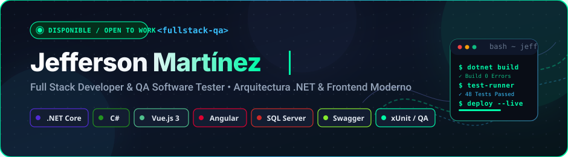

<div align="center">

<!-- Banner Vectorial Propio (Cero imágenes rotas, 100% confiable y nítido) -->


<br/><br/>

<!-- Typing SVG con JetBrains Mono -->
<a href="https://github.com/jeffersonm-dev">
  
</a>

<br/>

<!-- Badges de Estado Compactas y Alineadas -->
<p align="center">
  <a href="https://wa.me/584167071715"></a>
  &nbsp;
  
  &nbsp;
  
  &nbsp;
  <a href="mailto:logicnexus976@gmail.com"></a>
</p>

</div>

---

### 👨‍💻 Sobre Mí

```javascript
const jefferson = {
  nombre:       "Jefferson Martínez",
  rol:          "Full Stack Developer & QA / Software Tester",
  ubicacion:    "Venezuela 🇻🇪 (Remoto para cualquier parte del mundo)",
  mentalidad:   "Código limpio, arquitectura escalable y testing riguroso.",
  especialidad: {
    backend:    [".NET Core", "C#", "ASP.NET Web API", "Entity Framework Core", "JWT"],
    frontend:   ["Vue.js 3", "Angular", "TypeScript", "JavaScript", "HTML5", "CSS3"],
    databases:  ["SQL Server", "PostgreSQL", "MySQL", "Stored Procedures"],
    testing_qa: ["Swagger / OpenAPI", "xUnit", "Postman", "Pruebas de Integración"]
  }
};
```

> Desarrollador enfocado en entregar software confiable de punta a punta: desde la arquitectura del backend en **.NET Core** y bases de datos relacionales, hasta interfaces fluidas con **Vue.js y Angular**, garantizando siempre la calidad mediante pruebas automatizadas con **xUnit, Postman y Swagger**.

---

### 🛠️ Stack Tecnológico

<div align="center">

<a href="https://skillicons.dev">
  
</a>

<br/><br/>

| Área | Tecnologías Principales |
| :--- | :--- |
| **⚙️ Backend & APIs** | `C#` `.NET Core` `ASP.NET Web API` `RESTful APIs` `JWT Auth` `Entity Framework Core` |
| **🎨 Frontend & UI** | `Vue.js 3` `Angular` `TypeScript` `JavaScript` `HTML5` `CSS3` `Tailwind CSS` |
| **🗄️ Bases de Datos** | `SQL Server` `PostgreSQL` `MySQL` `Procedimientos Almacenados` `Optimización SQL` |
| **🧪 Testing, QA & Tools** | `Swagger / OpenAPI` `xUnit` `Postman` `Git` `GitHub` `VS Code` `Visual Studio` |

</div>

---

### 🚀 Proyectos Destacados

> 📄 *Para especificaciones de arquitectura, casos de uso y diagramas técnicos, visita **[PROJECTS.md](./PROJECTS.md)***

<div align="center">

<table width="100%">
  <tr>
    <td width="50%" valign="top">
      <h4>📡 01 — API RESTful .NET Core + Swagger</h4>
      <p>Servicio backend robusto con Clean Architecture, documentación interactiva Swagger/OpenAPI, autenticación JWT Bearer y persistencia con Entity Framework Core.</p>
      <p>
        
        
        
      </p>
      <a href="https://github.com/jeffersonm-dev/api-dotnet-swagger">
        
      </a>
    </td>
    <td width="50%" valign="top">
      <h4>🖥️ 02 — Aplicación Full Stack Vue.js + SQL</h4>
      <p>Single Page Application responsiva construida con Vue.js 3 (Composition API), consumo asíncrono de APIs en .NET Core y persistencia en Microsoft SQL Server.</p>
      <p>
        
        
        
      </p>
      <a href="https://github.com/jeffersonm-dev/vue-sql-app">
        
      </a>
    </td>
  </tr>
  <tr>
    <td width="50%" valign="top">
      <h4>🗄️ 03 — Gestor de Base de Datos Multi-Motor</h4>
      <p>Diseño y optimización relacional soportando PostgreSQL y MySQL simultáneamente. Procedimientos almacenados, transacciones y consultas de alto rendimiento.</p>
      <p>
        
        
        
      </p>
      <a href="https://github.com/jeffersonm-dev/database-management">
        
      </a>
    </td>
    <td width="50%" valign="top">
      <h4>🧪 04 — Suite de Testing Automatizado & QA</h4>
      <p>Entorno de aseguramiento de calidad con pruebas unitarias en xUnit, colecciones automatizadas en Postman y validación de contratos Swagger UI.</p>
      <p>
        
        
        
      </p>
      <a href="https://github.com/jeffersonm-dev/testing-suite">
        
      </a>
    </td>
  </tr>
</table>

</div>

---

### 📊 Actividad & Estadísticas de GitHub

<div align="center">

<table border="0">
  <tr>
    <td align="center" valign="middle">
      
    </td>
    <td align="center" valign="middle">
      
    </td>
  </tr>
  <tr>
    <td colspan="2" align="center">
      <br/>
      
    </td>
  </tr>
</table>

<br/>

<!-- Gráfico de Actividad de Contribuciones Dinámico -->


</div>

---

### 📬 Conectemos

<div align="center">

<p>¿Tienes un proyecto en mente, una vacante laboral o deseas colaborar? ¡Conversemos!</p>

<a href="https://wa.me/584167071715" target="_blank">
  
</a>
&nbsp;
<a href="mailto:logicnexus976@gmail.com">
  
</a>
&nbsp;
<a href="https://www.linkedin.com/in/jefferson-martinez-dev" target="_blank">
  
</a>
&nbsp;
<a href="https://www.instagram.com/jeffersonmartinez0114" target="_blank">
  
</a>
&nbsp;
<a href="https://www.facebook.com/share/181hmngqAf/" target="_blank">
  
</a>

<br/><br/>

| Canal | Contacto Directo |
| :--- | :--- |
| 💬 **WhatsApp** | [+58 416-7071715](https://wa.me/584167071715) |
| ✉️ **Correo Electrónico** | [logicnexus976@gmail.com](mailto:logicnexus976@gmail.com) |
| 💼 **LinkedIn** | [Jefferson Martínez](https://www.linkedin.com/in/jefferson-martinez-dev) |
| 📸 **Instagram** | [@jeffersonmartinez0114](https://www.instagram.com/jeffersonmartinez0114) |
| 👤 **Facebook** | [Jefferson Martinez](https://www.facebook.com/share/181hmngqAf/) |

</div>

---

<div align="center">

<!-- Contador de visitas oficial -->


<br/><br/>

<!-- Footer Vectorial Propio -->


</div>
